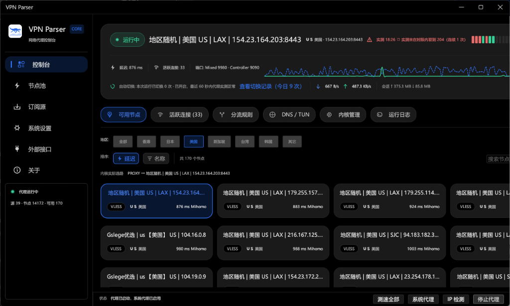

# VPN Parser

<p align="center">
  <a href="README.md">简体中文</a> | <b>English</b>
</p>

A high-performance, modern cross-platform proxy tool built with Rust and egui: collects subscriptions, parses nodes, drives proxy cores (Mihomo / sing-box / Xray), and performs real-world reachability and latency benchmarking.

<p align="center">
  
</p>

- **Windows**: Modern installer (Inno Setup) + one-click system proxy integration + TUN virtual adapter mode (with elevated privileges)
- **Linux**: Universal **AppImage** (standalone portable bundle), Debian/Ubuntu **deb**, and Fedora/RHEL **rpm** desktop packages, providing local mixed proxy listener (default `127.0.0.1:9980`)
- **OpenWrt**: Native **.ipk** service packages (`x86_64` / `aarch64_generic`) and universal **LuCI Web GUI (`luci-app-vpn-parser`)**, integrated `procd` supervisor and UCI configuration, ultra-lightweight headless microservice (~20MB memory) for routers, see [OpenWrt Deployment Guide](docs/openwrt.md)
- **macOS**: Native DMG / App packages with Apple Silicon and Intel architecture support

## Features

### 📡 Subscription & Ingestion
- Standard Subscription URLs (with `YYYY-MM-DD` date placeholder support)
- GitHub Gist automated discovery: directly extracts and registers gists into subscriptions
- Telegram Channels: parses `t.me/s/<channel>` web previews for share links and configurations
- Native Cloudflare WARP MASQUE registration and OpenRung official relay integration

### ⚡ Verification & Health
- TCP pre-screening followed by authentic kernel-level Google `generate_204` handshake latency benchmarking
- Optional real packet download throughput probing
- 24-hour health timeline graphs based on true connectivity measurements
- Automatic failover history and logging

### 🧠 Smart Policy Routing
- Kernel-layer routing: `PROXY(select) -> Auto(url-test) -> Fallback`, seamlessly switching egress without reloading configurations
- Application-layer failover scheduler: EWMA smoothed latency + circuit breaker + hysteresis + cooldown intervals
- Built-in smart policy groups: AI service unlocking, US streaming optimization, multi-thread download aggregation, and DIRECT bypass for domestic traffic

### 🌐 Routing Rules & Geo Data
- GEOSITE / GEOIP / Domain / Port / Process matching rules with live hit tracking
- Hot reload and online updates for GeoIP and GeoSite databases
- Full import/export support for Clash rules, JSON arrays, and Clash Verge snippets

### 🎨 User Interface & Internationalization (i18n)
- Multilingual interface supporting **English**, **Simplified Chinese**, **Traditional Chinese**, and **Japanese**
- Auto-detects system locale (`LANG` / `LC_*`) and falls back to English in non-Chinese environments
- 5 curated color themes + dark mode toggle
- Vector icon consistency and DPI-aware scaling (85% to 140%)
- Windows system tray, single-instance mutex, and local loopback firewall auto-configuration

### 🔌 Developer & API Services
- Local RESTful HTTP API (default `127.0.0.1:9980`, secured via Bearer token)
- Remote publisher service for cluster node distribution

## Supported Protocols

- **Parsing**: `ss`, `vmess`, `vless`, `trojan`, `hysteria2/hy2`, `wireguard`, `masque`, `socks5`, `http(s)`, Clash/Mihomo YAML, Base64, and mixed raw text.
- **Connection**: Driven by managed kernels (Mihomo / sing-box / Xray).

## Building from Source

### Prerequisites

Ensure you have Rust stable installed:
```bash
curl --proto '=https' --tlsv1.2 -sSf https://sh.rustup.rs | sh
```

### Windows (Scoop One-Line Install)
```powershell
# Install directly via GitHub Raw manifest without adding extra buckets
scoop install https://raw.githubusercontent.com/mateo-ki/vpn-parser/main/vpn-parser.json

# Update in the future
scoop update vpn-parser
```

### Windows Build
```bash
cargo build --release
```

### Linux
```bash
# Build binary
cargo build --release

# Package AppImage, DEB, and RPM
./scripts/build_linux_packages.sh
```

## OpenWrt Microservice Integration

VPN Parser natively supports OpenWrt router environments (x86_64 soft routers and ARM64 hardware routers), running as an ultra-lightweight headless microservice (~20MB memory footprint), automatically supplying **OpenClash**, **PassWall**, and **SSR-Plus** with purified, auto-failover, low-latency node pools.

- **Fast Installation**: Download the architecture `.ipk` and universal LuCI `.ipk`, then run `opkg install ./vpn-parser_*.ipk ./luci-app-vpn-parser_*.ipk` on your router;
- **Native LuCI Web GUI**: Navigate to `Services` ➔ `VPN Parser` in OpenWrt LuCI to inspect node health, trigger speedtests, manage sources, and tune microservice parameters;
- **Procd & UCI Integration**: Configured via `/etc/config/vpn-parser`, auto-restarted by `procd` (`/etc/init.d/vpn-parser`) within 5 seconds upon crash;
- **Router Plugins**: Point your OpenClash / PassWall subscription URL to `http://127.0.0.1:8080/api/export/clash?quality_only=true&limit=60` to enjoy continuous high-quality proxy node feeds;
- **Complete Documentation**: See the detailed [OpenWrt Deployment Guide](docs/openwrt.md).

## Disclaimer

1. **Purpose & Compliance**: This project is an open-source technical client tool licensed under the MIT License, developed exclusively for educational purposes, network protocol research, and network benchmarking. Users must strictly comply with local laws and regulations. Using this software for any unlawful or malicious activities is strictly prohibited. Users bear all legal liabilities and consequences; authors, contributors, and distributors assume no liability whatsoever.
2. **No Proxy Service Provided**: This project does not provide, host, distribute, or resell any proxy nodes, network routing, VPN services, or cross-border network acceleration. All nodes, subscriptions, and rules utilized within the application are strictly collected, imported, and configured by the users themselves.
3. **Zero Telemetry & Local Privacy**: This project adheres strictly to a zero-telemetry policy. There are no tracking, analytics, reporting, or profiling modules in the codebase. All configurations, node records, routing rules, and benchmark logs reside exclusively on the user's local disk (`data/` directory) and are never uploaded to any remote servers. The uninstaller does not forcefully delete local user databases.
4. **Transparent Network Activity**: In standard operation, network activity is strictly limited to inbound data retrieval: fetching user-specified subscriptions, detecting the public egress IP, checking and downloading application updates from official repositories, downloading proxy kernels and GeoIP/GeoSite rule databases, and performing DNS resolution for routing health checks.
5. **Explicit User-Initiated Outbound Data**: Beyond default inbound operations, data is only transmitted externally upon explicit manual user interaction: ① Publishing verified nodes to a user-configured self-hosted Web backend; ② Explicitly requesting an IP risk & geolocation inspection (which queries third-party providers ipinfo.io, ip-api.com, and ipwho.is).
6. **Third-Party Kernels & Rules**: Third-party proxy engines (VP-Core, Mihomo, sing-box, Xray, Meow, Shoes, etc.) and Geo databases are standalone open-source projects maintained by their respective upstreams under their own licenses. Displayed latencies, throughput speeds, and health metrics represent point-in-time local benchmark measurements and do not constitute a guarantee of future stability, availability, or performance.

## License

MIT License. See [LICENSE](LICENSE).
