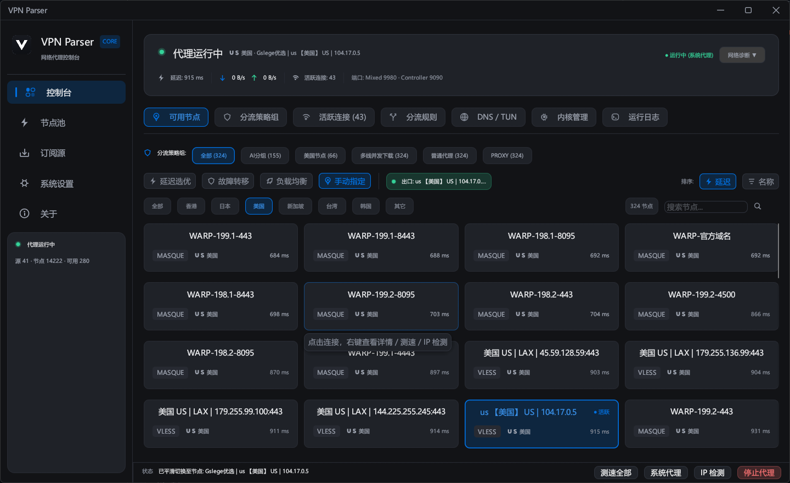

# VPN Parser

<p align="center">
  <a href="README.md">简体中文</a> | <b>English</b>
</p>

A high-performance, modern cross-platform proxy tool built with Rust and egui: collects subscriptions, parses nodes, drives proxy cores (Mihomo / sing-box / Xray), and performs real-world reachability and latency benchmarking.

<p align="center">
  
</p>

- **Windows**: Modern installer (Inno Setup) + one-click system proxy integration + TUN virtual adapter mode (with elevated privileges)
- **Linux**: Universal **AppImage** (standalone portable bundle), Debian/Ubuntu **deb**, and Fedora/RHEL **rpm** desktop packages, providing local mixed proxy listener (default `127.0.0.1:9980`)
- **macOS**: Native DMG / App packages with Apple Silicon and Intel architecture support

## Features

### 📡 Subscription & Ingestion
- Standard Subscription URLs (with `YYYY-MM-DD` date placeholder support)
- GitHub Gist automated discovery: directly extracts and registers gists into subscriptions
- Telegram Channels: parses `t.me/s/<channel>` web previews for share links and configurations
- Native Cloudflare WARP MASQUE registration and OpenRung official relay integration

### ⚡ Verification & Health
- TCP pre-screening followed by authentic kernel-level Google `generate_204` handshake latency benchmarking
- Optional real packet download throughput probing
- 24-hour health timeline graphs based on true connectivity measurements
- Automatic failover history and logging

### 🧠 Smart Policy Routing
- Kernel-layer routing: `PROXY(select) -> Auto(url-test) -> Fallback`, seamlessly switching egress without reloading configurations
- Application-layer failover scheduler: EWMA smoothed latency + circuit breaker + hysteresis + cooldown intervals
- Built-in smart policy groups: AI service unlocking, US streaming optimization, multi-thread download aggregation, and DIRECT bypass for domestic traffic

### 🌐 Routing Rules & Geo Data
- GEOSITE / GEOIP / Domain / Port / Process matching rules with live hit tracking
- Hot reload and online updates for GeoIP and GeoSite databases
- Full import/export support for Clash rules, JSON arrays, and Clash Verge snippets

### 🎨 User Interface & Internationalization (i18n)
- Multilingual interface supporting **English**, **Simplified Chinese**, **Traditional Chinese**, and **Japanese**
- Auto-detects system locale (`LANG` / `LC_*`) and falls back to English in non-Chinese environments
- 5 curated color themes + dark mode toggle
- Vector icon consistency and DPI-aware scaling (85% to 140%)
- Windows system tray, single-instance mutex, and local loopback firewall auto-configuration

### 🔌 Developer & API Services
- Local RESTful HTTP API (default `127.0.0.1:9980`, secured via Bearer token)
- Remote publisher service for cluster node distribution

## Supported Protocols

- **Parsing**: `ss`, `vmess`, `vless`, `trojan`, `hysteria2/hy2`, `wireguard`, `masque`, `socks5`, `http(s)`, Clash/Mihomo YAML, Base64, and mixed raw text.
- **Connection**: Driven by managed kernels (Mihomo / sing-box / Xray).

## Building from Source

### Prerequisites

Ensure you have Rust stable installed:
```bash
curl --proto '=https' --tlsv1.2 -sSf https://sh.rustup.rs | sh
```

### Windows
```bash
cargo build --release
```

### Linux
```bash
# Build binary
cargo build --release

# Package AppImage, DEB, and RPM
./scripts/build_linux_packages.sh
```

## License

GPL-3.0 License
