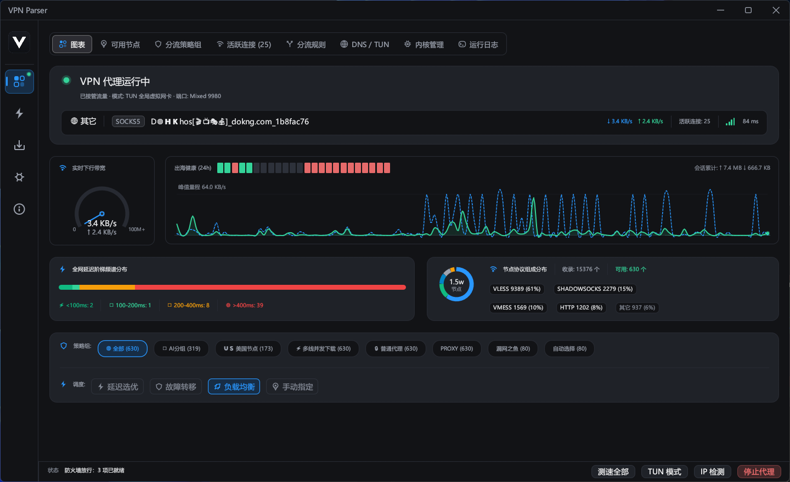

# VPN Parser

<p align="center">
  <b>简体中文</b> | <a href="README.en.md">English</a>
</p>

Rust + egui 编写的高性能现代化跨平台桌面代理工具：采集订阅、解析节点、驱动代理内核（Mihomo / sing-box / Xray），并实测代理可用性与延迟。

<p align="center">
  
</p>

- **Windows**：安装包（Inno Setup）+ 系统代理一键控制 + TUN 虚拟网卡模式（带管理员提权）
- **Linux**：通用免安装 **AppImage**、Debian/Ubuntu **deb** 与 Fedora/RHEL **rpm** 全套发布包支持，提供本地混合代理端口（默认 `127.0.0.1:9980`）
- **OpenWrt**：提供原生 **.ipk** 服务包（x86_64 / aarch64_generic）与通用 **LuCI Web 控制面板 (`luci-app-vpn-parser`)**，集成 `procd` 守护与 UCI 配置，超轻量无头微服务常驻路由器（~20MB 内存），详见 [OpenWrt 部署指南](docs/openwrt.md)
- **macOS**：原生 DMG 拖拽安装包与便携归档（Apple Silicon 与 Intel 架构支持）

## 功能

**采集**
- 订阅 URL（支持 `YYYY-MM-DD` 日期占位符）
- Gist 搜索页发现：把 gist raw 直接登记成订阅源
- Telegram 频道：读 `t.me/s/<频道>` 网页预览，裸节点链接和订阅链接都取，节点只增不删

**测速与健康**
- 先 TCP 预筛，再经内核访问 Google `generate_204` 计延迟，可选下载吞吐探测
- 出口健康条按最近 24 小时实测画，不看进程状态挂绿勾
- 出口切换记录落库留 90 天，按本地日分组，含"该切但没找到替补"

**选路**
- 内核层：`PROXY(select) → 自动选择(url-test) → 漏网之鱼`，换节点不重读配置
- 应用层：故障转移调度器（EWMA + 断路器 + 滞后 + 最小切换间隔）
- 替补池空了可自动补一轮低并发全量测速（默认关）

**分流规则**
- GEOSITE / GEOIP / 域名 / 端口 / 进程名等匹配器，规则可增删改
- 每条规则实际命中多少连接单独一页显示
- 导入 / 导出：吃 mihomo 规则文本、JSON 数组、Clash Verge 扩展脚本，解析后先给预览再落库

**代理与内核**
- 系统代理、TUN（提权交接后只留一个实例）、终端 `HTTP_PROXY` 三条都管
- 内核缺失时开下载窗口：ghfast / gh-proxy / 官方直连 / 走代理 / 本地导入，一次只走一条
- 按 exe 路径加防火墙允许规则；单实例互斥；托盘

**软件自身**
- 关于页在线更新，稳定与预发两个通道（默认只跟稳定版）
- 界面全中文、5 套浅色主题、Ctrl+K 命令面板、85%~140% 整页缩放
- 本地 HTTP API（默认 `127.0.0.1:8080`，强制 bearer 鉴权）
- 导出 mihomo / sing-box / xray 配置

## 协议

解析：`ss` `vmess` `vless` `trojan` `hysteria2/hy2` `socks5` `http(s)`，以及 Clash/Clash Meta YAML、Base64 与混合文本里的分享链接。
连接（取决于内核）：以上再加 `tuic` `wireguard`。`anytls` `ssr` `mieru` `openvpn` `sstp` 存得下但连不上，界面上会标出来而不是静默丢弃。

## 运行与打包

### 直接运行与编译
```bash
cargo run --release                 # 直接跑
cargo build --release               # 编译 release 二进制
```

### Windows 安装包
```powershell
# 编译 Inno Setup 安装向导，产物输出至 dist/
"<Inno Setup>\ISCC.exe" installer/vpn-parser.iss
```

### Linux 全套发行包 (AppImage / deb / rpm)
```bash
# 在 Linux / WSL 环境下一键生成全套 Linux 发布包并归档至 dist/
bash scripts/build_linux_packages.sh

# 或在 Windows 下调用 PowerShell 包装脚本自动化构建
powershell scripts/build_linux_packages.ps1
```

### OpenWrt 原生安装包 (.ipk)
```bash
# 交叉编译无头静态版本（以 x86_64 或 aarch64_generic 为例）
cross build --release --no-default-features --target x86_64-unknown-linux-musl

# 使用轻量级打包脚本生成 OpenWrt .ipk
./packaging/openwrt/make_ipk.sh target/x86_64-unknown-linux-musl/release/vpn-parser x86_64 dist
```

数据都在程序目录的 `data/` 下：主库 `vpn-parser.db`（订阅源、设置、遥测），节点按源分片存 `data/subscriptions/*.db`。

## OpenWrt 部署与微服务联动

VPN Parser 原生支持 OpenWrt 路由器环境（X86 软路由及 ARM64 路由器），作为轻量级本地微服务运行（常驻私有工作集内存仅约 20MB ~ 30MB），自动为 **OpenClash**、**PassWall**、**SSR-Plus** 等插件提供纯净、低延迟、自动保活的优质节点池。

- **快速安装**：下载对应架构的 `.ipk` 与通用 LuCI 插件包，在路由器中执行 `opkg install ./vpn-parser_*.ipk ./luci-app-vpn-parser_*.ipk`；
- **原生 LuCI 管理面板**：安装后在路由器后台「服务」➔「VPN Parser」即可进行节点池监控、真握手测速、订阅增删与参数调优；
- **配置与自启**：配置文件为 `/etc/config/vpn-parser`，由 `procd` 守护（`/etc/init.d/vpn-parser`）支持异常崩溃 5 秒自愈复活；
- **插件联动**：在 OpenClash 订阅地址填入 `http://127.0.0.1:8080/api/export/clash?quality_only=true&limit=60`，即可自动拉取最高质量的实测可用节点；
- **完整使用指南**：详见 [OpenWrt 部署与微服务联动指南](docs/openwrt.md)。

## 上手

1. 订阅源页加一条源（或跑一次 Gist / Telegram 发现），点拉取
2. 节点池点一个节点作为出口 → 启动代理（没装内核会自动开下载窗口）
3. 浏览器打不开境外时，先看表头那行实测健康，而不是看它有没有绿

## 已知边界

- 内核装在用户可写目录（`data/kernels`），TUN 提权时会以管理员执行其中的 exe
- url-test 只看"到测试 URL 的 HTTP 延迟"，不看带宽也不看落地 IP 信誉
- 免费共享订阅失效极快，测通数量长期偏低是常态

## 免责声明

- 本项目是 MIT 开源的技术工具，只解析订阅、管理节点，并在本机调用第三方代理内核；它自身不提供任何节点、线路或加速服务，用到的节点全部来自用户自己添加的订阅源。
- 使用者须遵守所在地区的法律法规，不得用于任何违法违规用途；因使用本项目产生的后果由使用者自行承担，作者与分发者不承担任何责任。
- 本项目没有统计上报模块：订阅地址、节点库、分流规则、测速与切换记录只存在本机 `data/` 目录，卸载程序也不会自动删除它们。
- 默认路径上的联网都是"取回数据"：拉取订阅源、检测出口 IP、检查与下载更新、下载内核与 GeoIP/GeoSite 规则库，以及为分流探测做解析的公共 DNS。
- 两处会向外送出信息，且都要用户主动触发：把节点发布到自建 Web 后台（送出测通的节点列表）、查询 IP 风险（把那个 IP 交给 ipinfo.io、ip-api.com、ipwho.is）。
- mihomo / sing-box / xray 等内核与 Geo 规则库均为第三方项目，按各自许可证分发，功能与稳定性由上游负责；界面显示的延迟与速率是本机当时的实测值，不代表节点之后的表现。

## 社区

本开源项目已链接并认可 [LINUX DO 社区](https://linux.do)。

## 许可证

MIT License，条款见 [LICENSE](LICENSE)。第三方内核（mihomo / sing-box / xray）与 Geo 规则库按各自的许可证分发，本仓库只调用其可执行文件、不重新授权它们。
